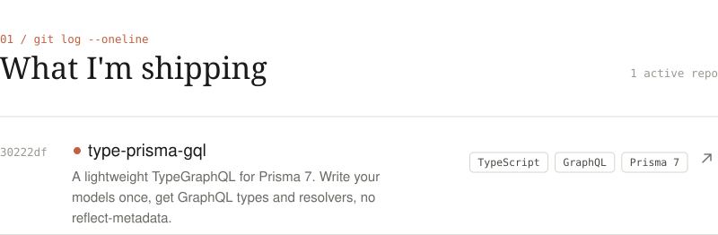
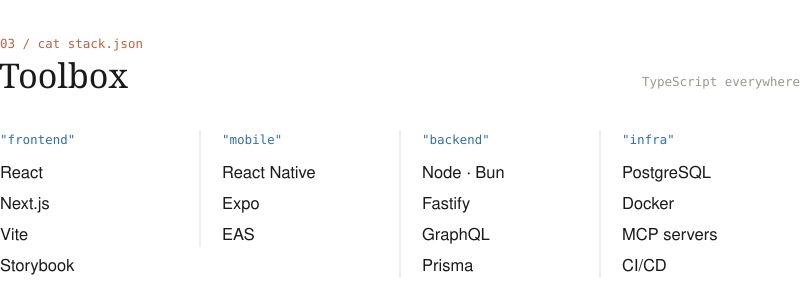

<picture>
  <source media="(prefers-color-scheme: dark)" srcset="page/hero-dark.svg?v=3">
  
</picture>

<a href="https://github.com/mo-fouad/type-prisma-gql">
<picture>
  <source media="(prefers-color-scheme: dark)" srcset="page/shipping-dark.svg">
  
</picture>
</a>

<picture>
  <source media="(prefers-color-scheme: dark)" srcset="page/how-dark.svg">
  
</picture>

<picture>
  <source media="(prefers-color-scheme: dark)" srcset="page/toolbox-dark.svg">
  
</picture>

<a href="mailto:mo.fouad.saga@gmail.com">
<picture>
  <source media="(prefers-color-scheme: dark)" srcset="page/contact-dark.svg">
  
</picture>
</a>

<picture>
  <source media="(prefers-color-scheme: dark)" srcset="page/footer-dark.svg">
  
</picture>
